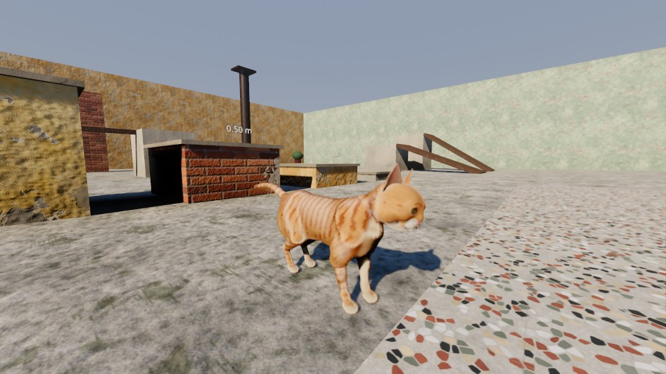

# player — Cam's controller, cameras, animation, fur, cat-sense

Owner paths: `scripts/player/`, `scripts/camera/`, `scenes/player/`, `shaders/fur*`,
`shaders/player_*`, `shaders/cat_sense*`, `tests/test_player*.gd`.



## What was built

| File | Role |
|---|---|
| `scenes/player/cat_player.tscn` | `CatPlayer` (CharacterBody3D, `class_name CatPlayer`, group `player`, layer 2, mask 1\|4\|6\|7\|8). Vertical cylinder collider r 0.085 × h 0.22 (crawl shrinks it to 0.135), `Visual` (slope-aligned model root), `CameraRig`. The real `assets/models/cat/cat.glb` is instanced at runtime under `Visual/Model`. |
| `scripts/player/cat_player.gd` | Controller (≈2.3 k lines). Modes `GROUND CROUCH AIR SCRAMBLE CLIMB SWIM TURN ACTION REST`; states emitted through `GameEvents.player_state_changed` (`idle idle_look walk trot run sneak sneak_idle crawl balance turn_left_90 turn_right_90 jump_crouch jump fall land land_hard scramble climb swim sit_down sit stand_up lie_down lie sleep groom knead stretch eat drink scratch pickup knock swipe hiss rub`). |
| `scripts/player/jump_planner.gd` | Precision-jump target search (ray fan + exact probe under the camera aim point, head-room + swept-arc validation, scoring of ledges/gaps/beams) and the exact ballistic solver. |
| `scripts/player/jump_reticle.gd` + `shaders/player_jump_reticle.gdshader`, `shaders/player_jump_arc.gdshader` | Landing ring aligned to the surface normal (squashed on beams) + dotted arc preview while charging. |
| `scripts/player/cat_animator.gd` | Runtime AnimationTree + modifier stack (see below), sockets `MouthSocket` (bone `mouth_socket`) and `EyeSocket` (bone `fpp_eye`). |
| `scripts/player/cat_procedural.gd` | `SkeletonModifier3D`: breathing (rate/depth from exertion; panting after a sprint, slow while asleep), spine bend into turns, random (slow-)blinks, crawl crouch, foot-IK targets and pelvis drop. |
| `scripts/player/cat_interaction.gd` | Focus selection (distance / interact_distance + view angle, LOS, hysteresis), prompt events, rim highlight (`shaders/player_focus.gdshader`). |
| `scripts/player/fur_shells.gd` (`class_name FurShells`) + `shaders/fur_base.gdshader`, `fur_shell.gdshader`, `fur_common.gdshaderinc` | Shell fur, reusable for NPC cats. |
| `scripts/player/cat_sense.gd` + `shaders/cat_sense.gdshader`, `cat_sense_highlight.gdshader` | Cat-sense post effect, highlights, scent trail. |
| `scripts/player/cat_fx.gd` | Surface-tinted dust puffs, splashes + rings, swim ripples, wet drips (GPUParticles3D one-shots). |
| `scripts/player/overlay_util.gd` | Shared helper to put overlay materials on a node's meshes (focus + sense highlights). |
| `scripts/camera/camera_rig.gd` | TPP orbit / FPP eye camera with animated blend. |
| `scenes/player/test_gym.tscn` (`test_gym.gd`) | Courtyard gym: ledges 0.15–2.0 m (labelled), stairs, 20°/32° ramps, beam / pipe / cable, climbable brick wall + drainpipe + tree trunk (layer 6), AC units up a facade to a roof, raised pool (water layer 7), table with knockable cups + chair, low car-like crawl gap, one interactable of every systems type. Procedural sky + sun + SDFGI + SSAO + AgX. |
| `scenes/player/fur_lab.tscn` (`fur_lab.gd`) | Look-dev stage for the fur (close/side/front/back views, sit/walk poses, wet, no-shells, shell debug). |

### Locomotion
- Analog speed → gaits walk 0.7 / trot 1.9 / run 5.0 (sprint) / sneak 0.45 / crawl 0.32 / balance 0.42 m/s, all
  multiplied by `GameState.get_modifier(move_speed|sprint_speed|sneak_speed|balance|wire_speed)`.
  Acceleration curve (run accel fades with speed), separate decel / hard brake, pivot-brake on sharp reversals.
- Turn rate blends 7.5 → 3.0 rad/s with speed; standing turns > 75° play `turn_left_90`/`turn_right_90`
  with the model yawed linearly over the clip (cat-asset convention). The spine bends into turns.
- Slope alignment: pitch/roll from 5 ground probes (front/back/left/right/centre), smoothed.
- Step-up ≤ 0.18 m (swept test, visual eased), step-down snapping on stairs/kerbs, nose probe (long
  body doesn't poke into walls), edge guard (stops at drops > 0.9 m unless the player keeps pushing for a
  moment / jumps). Cylinder collider + `safe_margin` 0.002, snap 0.21 m: no jitter on edges.
- Balance: support width measured by side rays; < ~12 cm → `balance` state, centring assist,
  `balance_walk` clip, slower turn rate. Crawl: auto when head-room < body height (low gaps).

### Jumping
- Tap = quick leap; hold = `jump_crouch` charge (0.55 s full). While charging (or holding `aim_jump`),
  the planner searches for the best landing within `max_jump_height 1.6 m × jump_height` and
  `max_jump_distance 2.5 m × jump_distance` along the camera/move direction; the reticle + arc show it.
  Release → velocity solved to land exactly; the analytic parabola is followed so it never misses.
  No target → free ballistic jump scaled by charge.
- Coyote time 0.12 s, jump buffer 0.15 s, ledge scramble/mantle when the chest reaches an edge
  (≤ 0.55 m above the paws), `land` / `land_hard` by fall height (> 2 m × jump_height modifier), fall
  damage via `player_damaged` beyond `safe_fall_height`, camera trauma on hard landings,
  `player_landed(speed, surface)` + `player_noise`.

### Contextual
- Climb (layer 6, near-vertical faces): `climb` clip at 0.5 m/s authored speed (time-scaled), mantle
  over walkable tops, jump-off backwards.
- Water (layer 7 Area3D or StaticBody): splash FX, `player_landed(.., &"water")` (GameState soaks the
  fur), swim at `water_level − 0.13` paddling to the nearest edge, scramble out, shake-off.
- Actions: meow (tap short/chirp/greet, hold loud), sit/groom (`sit_groom`, hold for lie/sleep),
  inactivity idles (look 9 s → sit 22 s → groom 40 s → lie 65 s → sleep 95 s), swipe (0.16 m paw
  sphere; `knock()` on Pushables, `on_swiped()` on NPCs/prey), pickup/drop into the mouth socket
  (held item visual via `PickupItem.create_item_visual`), knock, eat/drink/scratch/rub via
  `play_action()` called by the systems interactables. Dialogue locks movement and plays the
  `dialogue_choice_made` action. Faint/revive per systems.
- Shelter: syncs `AudioManager.set_sheltered()` from `GameState.is_sheltered()`.

### Animation (cat_animator.gd)
- AnimationTree built at runtime: `loco` = gait BlendSpace1D (idle · walk · trot · run, `sync`)
  ⨉ Blend2 with sneak BlendSpace1D → TimeScale matched to the real speed (no foot sliding);
  `balance` BlendSpace1D; an `AnimationNodeTransition` over loco + every contextual clip with
  per-state cross-fades; `OneShot` meow filtered to head/jaw/ears (meow while walking).
- Loop modes set at runtime for the looping clips (harmless duplicate of the import options).
- Modifier stack under `Skeleton3D`: `CatProcedural` → `TwoBoneIK3D` (4 legs, ray-cast ground,
  pelvis drop, poles at the knees/elbows) → `LookAtModifier3D` neck_02 + head + eyes toward the
  look target (camera view / points of interest, angle-limited) → `SpringBoneSimulator3D` (tail chain
  + both ears).
- Note for anyone testing poses: Godot 4.7 restores the animated pose after each skeleton update,
  so modifier results are only visible inside `Skeleton3D.skeleton_updated` (see `_posed()` in
  `tests/test_player_anim.gd`).

### Camera (camera_rig.gd)
TPP: SpringArm3D vs layers 1+9, physics-interpolated target, separate horizontal/vertical lag (no step bob),
auto-framing of targeted jumps, zoom 0.6–3.4 m, speed FOV boost, recentering after 1.8 s of
motion, trauma shake. FPP: `fpp_eye` socket, stabilised, gait-phase head-bob × `camera/head_bob`,
FOV max(fov+5, 80), near 0.015; head/eyes/whiskers hidden in the main pass only (still cast shadows),
paws/chest visible looking down. `toggle_camera` blends position/orientation/FOV/near over 0.55 s.
Mouse + gamepad look with `controls/*` settings, mouse captured except while menus are open.

### Fur
Base pass (`fur_base`): albedo/normal/ORM undercoat + fur lighting. 24 shells (Settings
`graphics/fur_shells`, 0 = base only) chained via `next_pass`: length from `cat_fur_mask.png` R
(× `fur_length` 0.02 m, guard hairs to 1.35×, tapered around eyes/mouth/nose/pads), density G,
comb direction from `cat_fur_flow.png` (tangent frame; `flow_sign_y = +1` verified numerically: dorsal
strands point to the tail), gravity droop, wind (`wind_*` globals), body inertia sway, clumping +
darkening + shortening when wet (`GameState.wetness` for the player, global `wetness` for NPCs),
two-lobe Kajiya-Kay specular, wrapped diffuse + warm terminator band, back-lit rim fuzz, root AO /
light tips. Only every 4th shell renders into shadow maps. Distance LOD for NPCs (`enable_lod`).
NPC use:
```gdscript
var fur := FurShells.new()
fur.albedo_override = load("res://assets/models/cat/textures/cat_albedo_black.png")
fur.use_game_state_wetness = false
fur.enable_lod = true
add_child(fur)
fur.attach_to_model(cat_instance, npc_body)
```

### Cat-sense
`cat_sense` action → `GameEvents.cat_sense_toggled(true)` (GameState charges energy), global
`cat_sense` eases 0→1: full-screen post quad (desaturate, whisker-edge detection, vignette, warm
scent tint), warm glow on interactables / cool glow on animals (`npc`/`prey` groups), drifting scent
motes from Cam toward `QuestManager.get_tracked_target_position()` (nav path when available). Range
× `scent_range` modifier. Auto-ends after its duration.

## Public API (CatPlayer)
Contract: `set_input_enabled(bool)`, `teleport(Transform3D)`, `get_camera_rig()`, `get_camera()`,
`get_mouth_attachment()`, `get_state()`, `is_first_person()`, `set_camera_mode(&"first_person"|&"third_person")`.
Extra: `toggle_camera()`, `play_action(name)`, `meow(kind)`, `swipe()`, `drop_mouth_item()`,
`face_point(p)`, `get_planar_speed()`, `get_speed_along_facing()`, `is_airborne()`, `is_sneaking()`,
`is_crawling()`, `is_balancing()`, `get_mode()`, `get_charge()`, `get_jump_target()`, `get_surface()`,
`get_water_level()`, `get_animator()`, `get_model()`, `get_visual()`, `get_look_target()`,
`get_gait_phase()`, `get_eye_transform_interpolated()`. Signals: `state_changed`, `landed`, `leapt`.
GameEvents emitted: `player_spawned`, `player_state_changed`, `player_jumped`, `player_landed`,
`player_damaged`, `player_noise`, `player_meowed`, `interactable_focused/unfocused`, `interacted`,
`cat_sense_toggled`. SFX for jump/land/meow/drop are played by AudioManager from those events;
footsteps via `AudioManager.play_footstep` 4× per gait cycle.

## How to regenerate / verify
Everything is code; no baked assets.
```bash
SKIP_IMPORT=1 tools/validate.sh "" /player/ ; SKIP_IMPORT=1 tools/validate.sh "" /camera/
tools/run_tests.sh player                       # 47 tests: locomotion, jump, context, interact, camera, anim
tools/screenshot.sh scene=res://scenes/player/test_gym.tscn out=$PWD/qa/out/player/x.png frames=40 size=960x540 call=demo_portrait
#   hooks: demo_tpp demo_close demo_fpp demo_fpp_down demo_aim demo_portrait demo_sense demo_wet demo_beam
tools/screenshot.sh scene=res://scenes/player/fur_lab.tscn out=$PWD/qa/out/player/f.png call=view_close
```

## Known gaps (honest)
- Fur at gameplay distance (1–2 m) reads as a soft velvet coat rather than individual hairs; the
  silhouette fuzz is subtle. Close-ups (fur lab) look good. No fins/silhouette cards.
- The procedural sky/sun of the gym is a stand-in for the world's time-of-day lighting (world area).
- Climb only on layer-6 surfaces with near-vertical faces; no ceiling/overhang traversal, no wall-run.
- Swim is a simple paddle-to-nearest-edge; no underwater state (cats avoid water by design).
- Foot IK is a vertical correction on planted paws (no foot rotation to the surface normal).
- Head look-at follows the camera view/POIs; no saccades beyond the eye bones' follow.
- Tests run headless (no rendering); visual behaviour was checked via screenshots only at a few poses.
- Software rendering (lavapipe) makes each screenshot take several minutes, so the number of visual
  iterations per change was limited.
